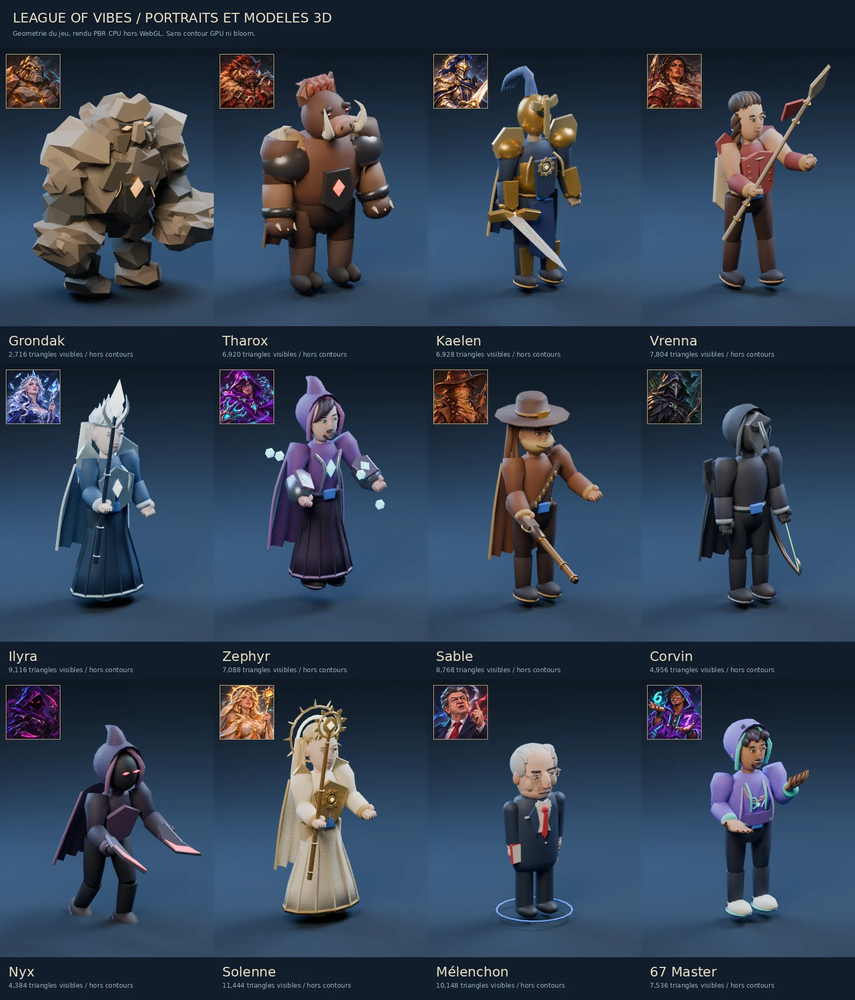

# League of Vibes

MOBA 4v4 natif pour Windows, Linux et macOS. Draft, trois voies, jungle, objectifs neutres, boutique, brouillard de guerre :
les mécaniques du genre, avec un univers, des champions et des assets originaux.

Écrit en Rust : client Bevy (rendu, effets, interface, audio), serveur autoritaire tokio + axum. Le jeu est construit par plusieurs contributeurs,
chacun sur sa machine avec ses propres IA : la marche à suivre est dans [CONTRIBUTING.md](CONTRIBUTING.md).

> Projet de fans, non affilié à Riot Games. Aucun nom, visuel, son ou texte de Riot n'est utilisé.



## Démarrer

**Jouer** : télécharge l'archive de ton système dans les [releases](../../releases), lance `lov-server`
sur une machine (ou utilise un serveur hébergé), écris son adresse dans `serveur.txt` à côté de
`lov-client` (ex. `192.168.1.20:3000`), puis lance `lov-client`.

**Développer** : Rust, avec la version de `rust-toolchain.toml` (rustup l'installe tout seul). Sous Linux,
Bevy demande `libasound2-dev libudev-dev libxkbcommon-dev libwayland-dev`.

```bash
DEV_LOBBY=1 cargo run -p lov-server            # serveur sur :3000
cargo run -p lov-client                        # client (autant de fois que de joueurs)
```

Crée une salle dans un client, rejoins-la avec le code dans un autre, puis lance la partie. `DEV_LOBBY=1`
autorise une salle de moins de 8 joueurs. Avec `LOV_AUTOPLAY=1`, le client crée une salle de dev et la lance
seul.

## Le jeu

- **Partie** : deux équipes de 4, phase de draft, puis la Faille des Vibes — trois voies, sbires, tours, inhibiteurs, nexus.
- **Jungle et objectifs** : camps neutres, drakes élémentaires et leurs âmes, Larves, Colosse du Rift, Léviathan.
- **Économie** : or, 101 objets avec recettes, boutique à la fontaine, rappel, balises de vision.
- **Sorts d'invocateur** : 9, deux par joueur.

### Champions

Le roster compte 13 champions, chacun avec son portrait et son modèle dédié.

| Champion | Titre | Classe | Voies |
|---|---|---|---|
| Corvin | l'Archer des Corbeaux | Tireur | bot |
| Grondak | le Rempart de Granit | Tank | top, jungle |
| Ilyra | la Sentinelle du Givre | Mage | mid |
| Kaelen | la Lame de l'Aube | Combattant | top |
| Nyx | l'Ombre Sans Nom | Assassin | mid, jungle |
| Sable | la Tireuse des Dunes | Tireur | bot |
| Solenne | la Prêtresse de l'Aube | Support | bot, mid |
| Tharox | la Charge Sauvage | Tank | jungle, top |
| Vrenna | la Lance des Steppes | Combattant | jungle, top |
| Zephyr | l'Arcaniste Instable | Mage | mid |
| 67 Master | le Grand Maître du Six-Sept | Mage | mid, bot |
| Mélenchon | le Tribun indigné | Mage | mid, bot |
| Le Touilleur | le Virtuose du Moulinet | Mage | mid, jungle |

Mélenchon est une caricature satirique. Le détail des sorts de chaque champion est affiché en jeu, dans le draft et au
survol des sorts.

### Commandes

| Touche | Action |
|---|---|
| Clic droit | Se déplacer, attaquer |
| A + clic | Attaque-déplacement |
| Q W E R | Sorts |
| Ctrl + Q/W/E/R | Monter un sort |
| D / F | Sorts d'invocateur |
| 1-3, 5-7 | Objets |
| 4 | Balise |
| B | Rappel |
| S | Stop |
| P | Boutique |
| Tab (maintenir) | Tableau des scores |
| C | Statistiques |
| Espace | Centrer la caméra |
| Y | Verrouiller la caméra |
| Alt + clic | Ping |
| Échap | Fermer, paramètres |

## Le Touilleur, le Virtuose du Moulinet

Mage de mêlée en manteau turquoise, moustache cuivrée et gant ivoire. Son index levé décrit un moulinet
continu en repos, course, attaques, sorts et rappel. Le doigt a un poste à temps plein.

| Touche | Sort | Effet |
|---|---|---|
| P | Ça monte à la tête | Trois impacts de sorts espacés sur des champions donnent dégâts bonus et vitesse |
| Q | Coup de doigt | Projectile sur le premier ennemi, dégâts et ralentissement |
| W | Tourbillon de poche | Zone retardée de dégâts et ralentissement |
| E | Pas de côté | Téléportation courte et bouclier |
| R | La grande touille | Passe derrière un champion, dégâts et étourdissement jusqu'à 2 s pendant une canalisation burlesque |

L'ultime respecte les murs, les limites de carte et les collisions : il ne touche pas si aucune arrivée
derrière la cible n'est possible. Ténacité et Purification fonctionnent ; contrôle dur/silence du lanceur,
ordre d'arrêt/déplacement, mort, stase ou rupture de proximité terminent le canal et son stun.

Modèle et animations : `LOV_VIEWLAB=1`. Sorts réellement simulés : `LOV_SPELLLAB=touilleur`. [Aperçu du portrait et du modèle](docs/previews/touilleur.webp).

## Développement

| Commande | Rôle |
|---|---|
| `cargo run -p lov-server` / `cargo run -p lov-client` | Serveur, client |
| `cargo test --workspace` | Tests, simulation sans fenêtre |
| `cargo clippy --workspace --all-targets -- -D warnings` | Lints, comme la CI |
| `cargo build --release -p lov-client -p lov-server` | Exécutables de production |

### Variables du serveur

| Variable | Effet |
|---|---|
| `PORT` | Port HTTP et WebSocket (3000 par défaut) |
| `DEV_LOBBY=1` | Toutes les salles en mode dev, draft accéléré (10 s par tour) |
| `SKIP_DRAFT=1` | Pas de draft : champions attribués automatiquement, la partie démarre directement |
| `LOV_PERF=1` | Journal toutes les 10 s : durée des ticks, snapshots, débit par client, retard de la boucle |

### Variables du client

| Variable | Effet |
|---|---|
| `LOV_URL` | Adresse du serveur (`ws://localhost:3000/ws` par défaut, ou `serveur.txt` à côté de l'exécutable) |
| `LOV_AUTOPLAY=1` | Connexion, salle de dev et lancement automatiques |
| `LOV_DEBUG=1` | Ligne de debug (état, unités, snapshots) |
| `LOV_SCREENSHOT=chemin.png` | Capture quelques secondes après l'entrée en jeu |

### Scènes de démo (sans serveur)

| Variable | Contenu |
|---|---|
| `LOV_SPELLLAB=<champion>` ou `all` | Sorts lancés en boucle sur la vraie simulation ; `LOV_LAB_SHOTS=<dossier>` garde des captures |
| `LOV_FXLAB=1` | Particules, décals, rubans et matériaux des effets |
| `LOV_VIEWLAB=1` | Tous les modèles et leurs animations |
| `LOV_UILAB=<écran>` | Écrans et HUD avec des données factices : `accueil`, `salon`, `draft`, `chargement`, `jeu`, `boutique`, `scores`, `reglages`, `fin` |
| `LOV_AUDIOLAB=1` | Galerie des sons synthétisés |
| `LOV_STRESS=<n>` | Scène de charge de n unités |

Les identifiants de champion sont les noms en minuscules (`nyx`, `grondak`…), plus `master67`, `melenchon` et `touilleur`.

### Test de charge

```bash
cargo run --release -p lov-server --example bots -- --url ws://localhost:3000/ws --bots 8 --seconds 30
```

Huit bots WebSocket rejoignent une salle, passent le draft et jouent. La CI le lance à chaque PR.

## Déploiement

Le serveur écoute le WebSocket sur `/ws`. `GET /health` renvoie
`{ ok, uptime, rooms, players }`.

Une partie vit en mémoire dans un seul processus : déploie **une seule instance**, sans répartition de charge.

```bash
docker build -t league-of-vibes .
docker run -p 3000:3000 league-of-vibes
```

- **Fly.io** : `fly launch` détecte le Dockerfile. Règle `internal_port = 3000`, un health check HTTP sur `/health`,
  `min_machines_running = 1` et `auto_stop_machines = false`, sinon la machine s'arrête en pleine partie.
- **Render** : *Web Service* avec le runtime Docker, health check `/health`.
- **Reverse proxy** (nginx, Caddy) : transmets l'upgrade WebSocket sur `/ws`.

## Contribuer

| Chemin | Contenu |
|---|---|
| `crates/lov-shared` | Types, protocole, données de jeu (champions, objets, monstres, structures) |
| `crates/lov-sim` | Simulation autoritaire : monde, systèmes, combat, sorts |
| `crates/lov-server` | Salles, draft, réseau |
| `crates/lov-client` | Rendu, effets, audio, interface, entrées |
| [`PLAN.md`](PLAN.md) | Design complet du jeu, architecture, contrats |
| [`CONTRIBUTING.md`](CONTRIBUTING.md) | **Comment bosser sur le dépôt**, de bout en bout |
| [`AGENTS.md`](AGENTS.md) | Les règles de collaboration, en référence |
| [`docs/REVIEW.md`](docs/REVIEW.md) | Relecture et merge des PR |
| `.github/areas.json` | Découpage du projet en areas (périmètre de chaque PR) |
| `docs/archive/` | Plans et journaux de la première phase du projet (périmés, gardés comme mémoire du design) |
| [`ASSETS.md`](ASSETS.md) | Source et licence de chaque asset |
| [`docs/champion-models.md`](docs/champion-models.md) | Vérification des modèles 3D |

Tout changement passe par une Pull Request vers `main` avec la CI verte. **Commence par
[CONTRIBUTING.md](CONTRIBUTING.md)** : une issue que tu t'assignes, une branche courte, une seule *area* par PR.
