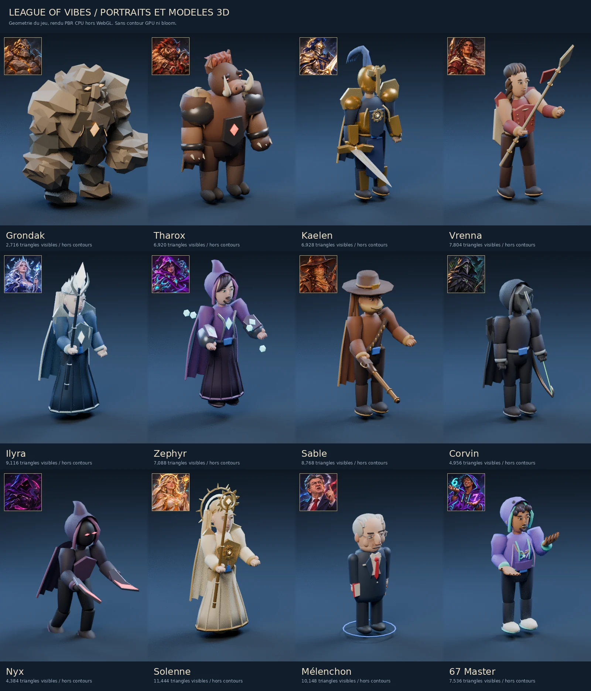

# League of Vibes

MOBA 4v4 jouable dans le navigateur. Draft, trois voies, jungle, objectifs neutres, boutique, brouillard de guerre :
les mécaniques du genre, avec un univers, des champions et des assets originaux.

Rendu 3D Three.js, interface Preact, serveur autoritaire Node. Le jeu est construit par plusieurs contributeurs,
chacun sur sa machine avec ses propres IA : la marche à suivre est dans [CONTRIBUTING.md](CONTRIBUTING.md).

> Projet de fans, non affilié à Riot Games. Aucun nom, visuel, son ou texte de Riot n'est utilisé.



## Démarrer

Node 24, la version de `.nvmrc` et de la CI.

```bash
npm install
npm run dev     # serveur sur :3000, client Vite sur :5173
```

Ouvre <http://localhost:5173/?dev=1> dans deux onglets : crée une salle dans le premier, rejoins-la avec le code dans
le second, puis lance la partie. Le paramètre `?dev=1` autorise une salle de moins de 8 joueurs.

Pour la version de production : `npm run build && npm start`, puis <http://localhost:3000>.

## Le jeu

- **Partie** : deux équipes de 4, phase de draft, puis la Faille des Vibes — trois voies, sbires, tours, inhibiteurs, nexus.
- **Jungle et objectifs** : camps neutres, drakes élémentaires et leurs âmes, Larves, Colosse du Rift, Léviathan.
- **Économie** : or, 101 objets avec recettes, boutique à la fontaine, rappel, balises de vision.
- **Sorts d'invocateur** : 9, deux par joueur.

### Champions

Le roster compte 13 champions, chacun avec son portrait et son modèle dédié.

| Champion | Titre | Classe | Voies |
|---|---|---|---|
| Corvin | l'Archer des Corbeaux | Tireur | bot |
| Grondak | le Rempart de Granit | Tank | top, jungle |
| Ilyra | la Sentinelle du Givre | Mage | mid |
| Kaelen | la Lame de l'Aube | Combattant | top |
| Nyx | l'Ombre Sans Nom | Assassin | mid, jungle |
| Sable | la Tireuse des Dunes | Tireur | bot |
| Solenne | la Prêtresse de l'Aube | Support | bot, mid |
| Tharox | la Charge Sauvage | Tank | jungle, top |
| Vrenna | la Lance des Steppes | Combattant | jungle, top |
| Zephyr | l'Arcaniste Instable | Mage | mid |
| 67 Master | le Grand Maître du Six-Sept | Mage | mid, bot |
| Mélenchon | le Tribun indigné | Mage | mid, bot |
| Le Touilleur | le Virtuose du Moulinet | Mage | mid, jungle |

Mélenchon est une caricature satirique. Le détail des sorts de chaque champion est affiché en jeu, dans le draft et au
survol des sorts.

### Commandes

| Touche | Action |
|---|---|
| Clic droit | Se déplacer, attaquer |
| A + clic | Attaque-déplacement |
| Q W E R | Sorts |
| Ctrl + Q/W/E/R | Monter un sort |
| D / F | Sorts d'invocateur |
| 1-3, 5-7 | Objets |
| 4 | Balise |
| B | Rappel |
| S | Stop |
| P | Boutique |
| Tab (maintenir) | Tableau des scores |
| C | Statistiques |
| Espace | Centrer la caméra |
| Y | Verrouiller la caméra |
| Alt + clic | Ping |
| Échap | Fermer, paramètres |

## Le Touilleur, le Virtuose du Moulinet

Mage de mêlée en manteau turquoise, moustache cuivrée et gant ivoire. Son index levé décrit un moulinet
continu en repos, course, attaques, sorts et rappel. Le doigt a un poste à temps plein.

| Touche | Sort | Effet |
|---|---|---|
| P | Ça monte à la tête | Trois impacts de sorts espacés sur des champions donnent dégâts bonus et vitesse |
| Q | Coup de doigt | Projectile sur le premier ennemi, dégâts et ralentissement |
| W | Tourbillon de poche | Zone retardée de dégâts et ralentissement |
| E | Pas de côté | Téléportation courte et bouclier |
| R | La grande touille | Passe derrière un champion, dégâts et étourdissement jusqu'à 2 s pendant une canalisation burlesque |

L'ultime respecte les murs, les limites de carte et les collisions : il ne touche pas si aucune arrivée
derrière la cible n'est possible. Ténacité et Purification fonctionnent ; contrôle dur/silence du lanceur,
ordre d'arrêt/déplacement, mort, stase ou rupture de proximité terminent le canal et son stun.

Portrait, modèle et moulinet : `?modellab&champ=touilleur`. Sorts réellement simulés :
`?fxlab&champ=touilleur&close=1`. [Aperçu du portrait et du modèle](docs/previews/touilleur.webp).

## Développement

| Commande | Rôle |
|---|---|
| `npm run dev` | Serveur (tsx watch) et client (Vite) |
| `npm run dev:server` / `npm run dev:client` | L'un ou l'autre seul |
| `npm run typecheck` | TypeScript strict sur les trois paquets |
| `npm test` | Tests vitest, simulation sans navigateur |
| `npm run build` | Build du client dans `packages/client/dist` |
| `npm start` | Serveur de production, qui sert aussi le client construit |

### Variables du serveur

| Variable | Effet |
|---|---|
| `PORT` | Port HTTP et WebSocket (3000 par défaut) |
| `DEV_LOBBY=1` | Toutes les salles en mode dev, draft accéléré (10 s par tour) |
| `SKIP_DRAFT=1` | Pas de draft : champions attribués automatiquement, la partie démarre directement |
| `LOV_PERF=1` | Journal toutes les 10 s : durée des ticks, snapshots, débit par client, retard de la boucle |

Exemple : `SKIP_DRAFT=1 DEV_LOBBY=1 npm run dev:server`.

### Pages de démo

Elles s'ouvrent sur le client seul (`npm run dev:client`), sans serveur.

| URL | Contenu |
|---|---|
| `?fxlab` | Sorts et effets, pilotés par la vraie simulation du serveur. `&champ=<id>` choisit le champion |
| `?modellab` | Modèles 3D et animations, à côté du portrait de référence. `&champ=<id>` |
| `?melenchonlab` | Vitrine du modèle de Mélenchon |
| `?maplab` | Carte seule |
| `?uilab=home`, `?uilab=draft`, `?uilab=game` | Écrans et HUD avec des données factices |

Les identifiants de champion sont les noms en minuscules (`nyx`, `grondak`…), plus `master67`, `melenchon` et `touilleur`.

### Test de charge

```bash
npx tsx scripts/bots.ts --url ws://localhost:3000/ws --bots 8 --seconds 30
```

Huit bots WebSocket rejoignent une salle et jouent. La CI lance ce script à chaque PR.

## Déploiement

Le serveur sert le client construit et le WebSocket sur le même port. `GET /health` renvoie
`{ ok, uptime, rooms, players }`.

Une partie vit en mémoire dans un seul processus : déploie **une seule instance**, sans répartition de charge.

```bash
docker build -t league-of-vibes .
docker run -p 3000:3000 league-of-vibes
```

- **Fly.io** : `fly launch` détecte le Dockerfile. Règle `internal_port = 3000`, un health check HTTP sur `/health`,
  `min_machines_running = 1` et `auto_stop_machines = false`, sinon la machine s'arrête en pleine partie.
- **Render** : *Web Service* avec le runtime Docker, health check `/health`. En runtime Node : build
  `npm ci && npm run build`, start `npm start`.
- **Reverse proxy** (nginx, Caddy) : transmets l'upgrade WebSocket sur `/ws`.

## Contribuer

| Chemin | Contenu |
|---|---|
| `packages/shared` | Types, protocole, données de jeu (champions, objets, monstres, structures) |
| `packages/server` | Simulation autoritaire, salles, draft, réseau |
| `packages/client` | Rendu, effets, audio, interface |
| [`PLAN.md`](PLAN.md) | Design complet du jeu, architecture, contrats |
| [`CONTRIBUTING.md`](CONTRIBUTING.md) | **Comment bosser sur le dépôt**, de bout en bout |
| [`AGENTS.md`](AGENTS.md) | Les règles de collaboration, en référence |
| [`docs/REVIEW.md`](docs/REVIEW.md) | Relecture et merge des PR |
| `.github/areas.json` | Découpage du projet en areas (périmètre de chaque PR) |
| `docs/archive/` | Plans et journaux de la première phase du projet (périmés, gardés comme mémoire du design) |
| [`ASSETS.md`](ASSETS.md) | Source et licence de chaque asset |
| [`docs/champion-models.md`](docs/champion-models.md) | Vérification des modèles 3D |

Tout changement passe par une Pull Request vers `main` avec la CI verte. **Commence par
[CONTRIBUTING.md](CONTRIBUTING.md)** : une issue que tu t'assignes, une branche courte, une seule *area* par PR.
