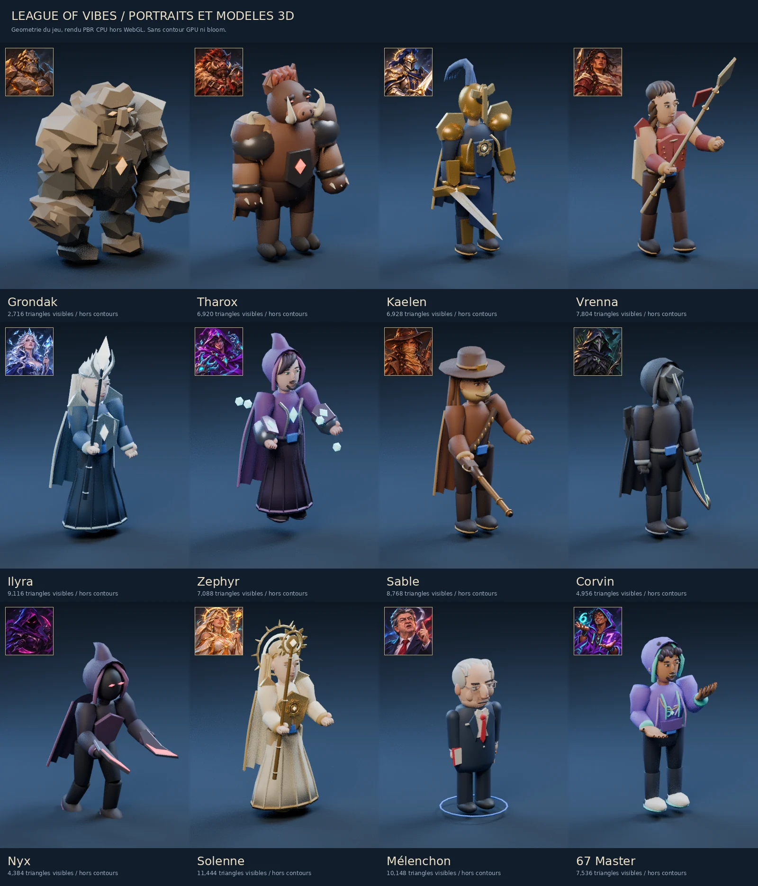

# Modèles de champions — vérification visuelle

Les douze portraits existants servent de référence. Les volumes sont générés par le code du jeu, sans
texture ni modèle tiers. Les onze modèles du pipeline commun conservent leur rig, leurs clips et leurs
effets animés. Mélenchon conserve son rig particulier, son index accusateur et son aura républicaine.



## Correspondances

| Champion | Éléments repris du portrait |
|---|---|
| Grondak | Visage taillé dans la roche, sourcils massifs, épaules minérales, failles de magma |
| Tharox | Museau, défenses courbes, crinière rouge, manteau de fourrure, armure sombre |
| Kaelen | Heaume à visière, plumet bleu, armure dorée, tabard, épée et soleils |
| Vrenna | Longue tresse, cuir rouge, foulard crème, lance et fanion |
| Ilyra | Cheveux argentés, couronne de glace, robe bleue, épaulières et bâton cristallin |
| Zephyr | Capuche ouverte pointue, frange asymétrique, robe violette, gantelets et cristaux cyan |
| Sable | Chapeau à large bord, foulard, manteau, cartouchière et fusil en bois/laiton |
| Corvin | Masque à bec, yeux verts, mantelet de plumes, arc ouvert et corde lumineuse |
| Nyx | Visage masqué, yeux roses, cape violette, deux dagues courbes |
| Solenne | Cheveux dorés, robe ivoire, armure dorée, auréole rayonnante et sceptre solaire |
| Mélenchon | Front dégagé, cheveux gris, lunettes rectangulaires, nez marqué, costume et cravate rouge |
| 67 Master | Boucles, sourire/barbe, hoodie violet/cyan, bijoux, doigts articulés avec les avant-bras, paumes ouvertes |

## Atelier interactif

```bash
npm install
npm run dev:client
# http://localhost:5173/?modellab
# http://localhost:5173/?modellab&champ=master67
```

- Sélectionner chacun des douze champions et comparer le portrait au modèle.
- Tourner/zoomer, passer en vue de jeu et vérifier les silhouettes et les armes.
- Essayer course, attaque, Q/W/E/R, mort puis retour. Les gestes du 67 restent présents en course/incantation.
- Pour les FX et les règles simulées, utiliser `?fxlab` ; l'atelier n'envoie pas de commandes au serveur.
- Vérifier Nyx pendant l'invisibilité dans le labo FX : tissu, métal et lumières deviennent translucides ensemble.

## Budget et contrôles

Le corps et les accessoires fixes sont fusionnés en lots skinnés par matière. Le métal utilise son propre
lot ; peau/tissu gardent leur rugosité. Les normales sculptées sont préservées et transformées avec les
pièces. Les anciens modèles de secours gardent leur ombrage à facettes. Les variations de matière ne
créent pas un mesh par bouton, doigt ou rivet.

Au repos, la géométrie visible hors contours va de 2 716 triangles (Grondak) à 11 444 (Solenne).
Les tests bornent à 25 000 triangles par champion avec contours/effets inclus ; les limites plus strictes
de Mélenchon (<14 000) et du 67 Master (<16 000, 3 meshes) restent respectées. Mélenchon passe de
66 à 27 meshes visibles au repos grâce à la fusion des pièces fixes par articulation/matière.
Ces nombres décrivent la géométrie, pas les appels additionnels des passes d'ombre ni un FPS garanti.

Les tests couvrent les attributs et index valides, les poids de skinning, les déformations finies et bornées
pendant Q/W/E/R, les normales sous échelle non uniforme/rotation, le métal distinct, l'invisibilité et la
libération des nouvelles ressources fusionnées. Les tests précédents des gestes, de mort/retour, des
sorts et du réseau restent exécutés.

## Reproduire les rendus hors WebGL

Node avec les dépendances du dépôt ; Blender 4.3+ pour le rendu CPU (outil de contrôle optionnel,
aucune dépendance du jeu). Les fichiers temporaires restent hors du dépôt.

```bash
node --import tsx packages/client/tools/exportChampionModels.ts /tmp/champion-models.json
blender -b -t 4 -P packages/client/tools/renderChampionModels.py -- /tmp/champion-models.json /tmp/champion-renders
# Ajouter des identifiants après le dossier pour ne rendre que certains champions.
```

L'export utilise les véritables vues du jeu, leur pose au repos déformée par les os, les couleurs linéaires,
les normales et les paramètres de matière. L'éclairage et le tone mapping Blender diffèrent du jeu.
La planche est un contrôle de géométrie/matières, pas une capture du moteur WebGL. Aucun contrôle
WebGL interactif ni mesure de FPS n'a été possible dans l'environnement de développement distant.
